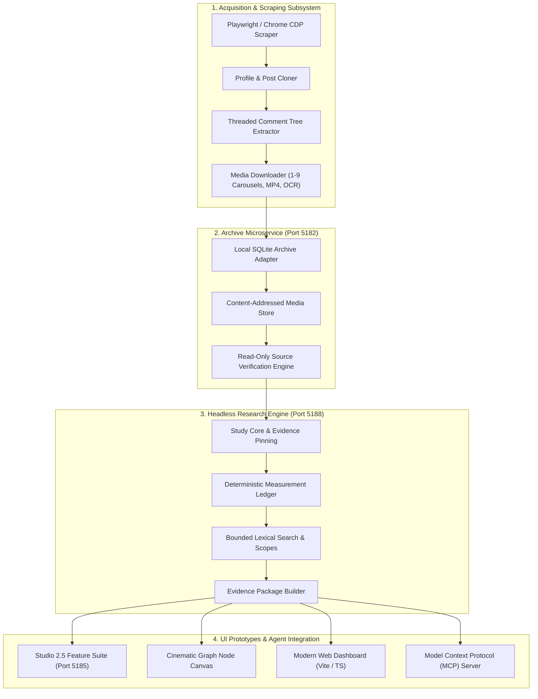

# RedNote Scraper Engine & UI Prototype

A modular, production-grade headless scraping engine, immutable research foundation, and interactive UI prototype suite for **RedNote (Xiaohongshu / 小红书)**.

---

## 🌟 Architecture Overview



---

## 📁 Repository Structure

```text
├── engines/
│   ├── headless_research/     # Headless research service (study_core, storage, CLI, dual startup)
│   ├── rednote_v2/            # Modern headless CDP engine, browser automation, live search
│   ├── rednote_modular/       # Modular crawlers, parsers, taxonomy, media managers, database
│   └── rednote_microservice/  # Dedicated read-only archive microservice (Port 5182)
│
├── scraper/                   # Core scraping & harvesting command scripts
│   ├── browser_capture.py     # Interactive browser capture engine
│   ├── profile_clone.py       # Full profile cloning with multi-tier comment trees
│   ├── threads_extractor.py   # Deep nested comment discussion extractor
│   ├── media_reporting.py     # Media file verification & asset integrity auditing
│   ├── harvest_mcp.py         # MCP server interface for autonomous agents
│   └── desktop_bridge.py      # Desktop automation bridge & window management
│
├── ui_prototypes/
│   ├── studio_25/             # Studio 2.5 Feature Prototype (Port 5185 presentation server)
│   ├── cinematic_graph/       # Cinematic graph-based research canvas & node controller
│   ├── studio_22/             # Studio 2.2 research & evidence explorer
│   └── web_dashboard/         # Modern Vite + TypeScript UI frontend application
│
├── data_schemas/
│   └── scatter_narrative_schema.sql  # Neuro-symbolic fiction state database schema
│
├── docs/                      # In-depth architectural & integration specifications
│   ├── ARCHITECTURE_SPECIFICATION.md # Master architecture blueprint & edge-case audits
│   ├── MCP_INTEGRATION_GUIDE.md      # Model Context Protocol setup for AI agents
│   └── AI_ACTION_GUIDE.md            # Execution guides for autonomous coding assistants
│
├── tests/                     # Unit and integration test suites
│   ├── test_rednote_extractor.py
│   ├── test_rednote_modular.py
│   └── test_legacy_rednote_guard.py
│
├── requirements.txt           # Python dependency manifest
├── LICENSE                    # MIT License
└── README.md                  # System documentation & quickstart
```

---

## 🚀 Key Subsystems

### 1. Headless Acquisition Engine (`engines/rednote_v2/` & `scraper/`)
* **Anti-Bot & Stealth Session Management**: Controlled Chromium CDP automation preventing bot detection and session invalidation.
* **Full Carousel & Media Harvest**: Downloads all 1–9 image carousels, live photos, and video keyframes with SHA-256 content verification.
* **Deep Nested Comment Trees**: Extracts top-level comments and child discussion replies with author provenance and engagement signals.

### 2. Immutable Research Foundation (`engines/headless_research/`)
* **Pinned Study Manifests**: Defines bounded research questions across selected profiles and posts. Computes SHA-256 source hashes to prevent silent modification.
* **Deterministic Runs**: Recomputes source hashes on read and flags changes as `source_changed` or `source_missing` rather than silently replacing data.
* **Evidence Packaging**: Aggregates verified text, media descriptors, and machine-translation reading aids into capped context packages (under 96 KB) ready for human or AI review.

### 3. UI Prototypes (`ui_prototypes/`)
* **Studio 2.5 (`studio_25/`)**: Local presentation environment at `http://127.0.0.1:5185/red-engine-features.html` for study creation, evidence review, and measurement auditing.
* **Cinematic Graph Canvas (`cinematic_graph/`)**: Dark-themed node-graph canvas connecting scraped post nodes, profile hierarchies, and narrative branches.
* **Web Dashboard (`web_dashboard/`)**: Modern responsive web interface built with Vite and TypeScript.

### 4. Agentic AI & MCP Integration (`scraper/harvest_mcp.py` & `docs/`)
* Native **Model Context Protocol (MCP)** tool server enabling Claude, Codex, or Gemini to:
  * Check capture status and inspect profile inventories.
  * Trigger targeted single-post or profile extractions.
  * Query threaded comments and extract contextual evidence safely.

---

## ⚡ Quick Start

### 1. Prerequisites
Ensure Python 3.10+ and Node.js 18+ are installed.

```bash
# Clone the repository
git clone https://github.com/Oceanwaveii2/RedNote-Scraper-Engine.git
cd RedNote-Scraper-Engine

# Install Python dependencies
pip install -r requirements.txt

# Install Playwright browser binaries
playwright install chromium
```

### 2. Launching Headless Services
To spin up both the read-only archive service (port 5182) and the headless research service (port 5188):

```powershell
powershell -File engines/headless_research/Start-RedNoteEngines.ps1
```

Or run the research engine directly:
```bash
python engines/headless_research/research_service.py
```

### 3. Running Headless Studies via CLI
```bash
# 1. Inspect current archive coverage
python engines/headless_research/study_cli.py coverage

# 2. Create an immutable research study
python engines/headless_research/study_cli.py create --title "Market Sentiment" --question "User engagement patterns" --profile-id "<PROFILE_ID>"

# 3. Execute a deterministic measurement run
python engines/headless_research/study_cli.py measure <STUDY_ID>

# 4. Search exact text within the pinned study
python engines/headless_research/study_cli.py search <STUDY_ID> "query"
```

### 4. Running UI Prototypes
```bash
# Launch Studio 2.5
cd ui_prototypes/studio_25
python server.py
# Open browser at: http://127.0.0.1:5185/red-engine-features.html

# Launch Cinematic Graph Canvas
cd ../cinematic_graph
python server.py
# Open browser at: http://127.0.0.1:5186
```

---

## 🌐 Network & Port Reference

| Port | Service | Description |
|:---:|:---|:---|
| **5182** | Archive Microservice | Read-only SQLite archive and media adapter |
| **5185** | Studio 2.5 Presentation Host | Local UI server proxying research API endpoints |
| **5186** | Cinematic Graph Canvas | Node-based visual narrative and evidence canvas |
| **5188** | Headless Research Service | Core study engine, evidence pinning, measurement ledger |

---

## 🧪 Testing

Execute test suites using `pytest`:

```bash
pytest tests/ -v
```

---

## 📄 License

This project is licensed under the [MIT License](LICENSE).
