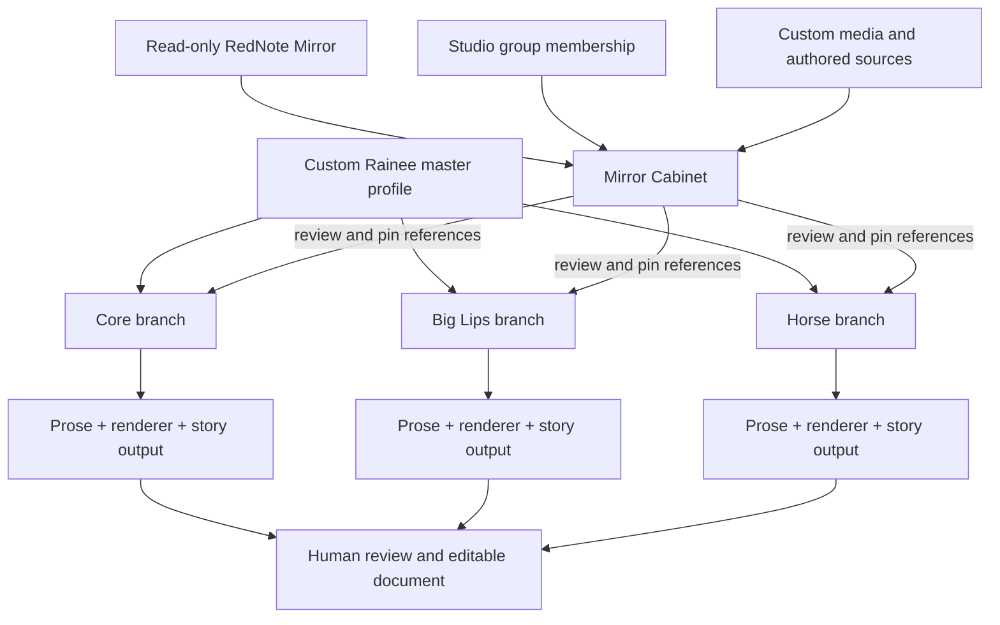

# Scatter Engine v3 — communication brief

**Date:** October 14, 2026  
**Status:** Engine and UI prototype. It needs more integration, source coverage, provider verification, and performance work.  
**Repository:** [Oceanwaveii2/RedNote-Scraper-Engine](https://github.com/Oceanwaveii2/RedNote-Scraper-Engine)  
**Review branch:** [`codex/scatter-v3-engine`](https://github.com/Oceanwaveii2/RedNote-Scraper-Engine/tree/codex/scatter-v3-engine)  
**Draft PR:** [#1 — Start Scatter Engine v3 replacement path](https://github.com/Oceanwaveii2/RedNote-Scraper-Engine/pull/1)  
**Verified code baseline:** `2d35b2aac28da285020beda5d037e51671d54237` (the later document-only commit does not change this baseline)

This document is the starting point for the next AI or human reviewer. Read the code and [technical handoff](ARGON_SCATTER_V3_HANDOFF_2026-10-14.md) before changing it. The board is included in the review branch under [`ui_prototypes/cinematic_graph/`](../ui_prototypes/cinematic_graph/). Do not infer that a visual card, a linked project, or a queued run has processed all its source data.

## The intended product, in plain language

Scatter is a visual story system. Rainee is an **authored custom character**, not a captured RedNote profile. A master character profile sits above three branches: **Core**, **Big Lips**, and **Horse**. Each branch can own a different character state, profile references, posts, video, story plan, and one or more story outputs. More branches must be possible later. The user should be able to work on or render one branch without sending unrelated sibling-branch data to the model.

The Mirror Cabinet is a shelf inside the graph for reading captured RedNote profiles and Studio groups. Dragging a profile or group onto the board should create a **reference to its archived ID**, not a second clone. A group is a meaningful collection of member profiles that can be read together, while preserving each member's identity. The user opens a profile to browse posts. Posts begin included; a graph-local negative/Ignore choice excludes one from that placement's story context without changing Mirror Storage. A post can have a graph-local JSON override. A captured comment avatar should link to the real commenter profile in the app's live RedNote window; the commenter's full page need not be cloned.

Custom music, video, art, and Rainee character material belong to separate Custom Storage. Big Lips and Horse may have bespoke board designs before their actual RedNote source material is captured. A designed card is **not** evidence that its archive source exists. Music can steer a branch through an interpreter; video is branch story context. A story output is intended to have a Prose Engine node and a separate LLM rendering session. Data analysis and text rendering are different jobs. Generated text is a proposal for human review and document editing.



The diagram shows the **intended flow**, not a claim that all arrows work end to end today.

## What exists now

| Area | Implemented | Boundary or gap |
| --- | --- | --- |
| Revisioned graph | [`graph.py`](../engines/scatter_graph/graph.py) stores typed nodes/ports/edges, atomic commands, immutable revisions, stale-revision checks, and restore. | The board's custom card layout is still a separate browser projection; most saved cards are not semantic graph nodes. |
| Source references | [`source_adapter.py`](../engines/scatter_graph/source_adapter.py) pins archive/study records by IDs and content hash, reads the Mirror archive without writing it, and reports changed sources. | Dragging a visual profile into the board does not automatically create a reviewed source pin or process it. |
| Groups and branch compilation | [`execution.py`](../engines/scatter_graph/execution.py) can walk typed upstream paths, compile separate outputs, and keep member profiles distinct. | The board's Studio groups and visual wires are not fully bound to this graph. Large compiled selections still materialize their included posts. |
| Story queue and documents | [`story_pipeline.py`](../engines/scatter_graph/story_pipeline.py) freezes bounded packets, queues stages, records receipts/events, and supports candidate selection, plan resolution, cancellation, interruption handling, and proposed drafts. [`documents.py`](../engines/scatter_graph/documents.py) provides revisioned editing. | Queueing is not a model response. No completed end-to-end story/document acceptance was established by the latest tests. |
| Providers | [`providers.py`](../engines/scatter_graph/providers.py) contains Codex and Gemini dispatch paths; an earlier source-backed Codex interpretation reached human selection. | The latest test did **not** start a provider. A Gemini conversation previously stalled with unknown outcome. Grok is not wired. Typed GPT/Gemini/Grok switches on the LLM node are settings, not proof of working sessions. |
| Graph API | [`api.py`](../engines/scatter_graph/api.py) serves the headless service on `127.0.0.1:5189`, separate from its worker. | The API is not the current visual board's sole authority. Old `/api/scatter/*` pipeline callers still exist. |
| Visual board | [`ui_prototypes/cinematic_graph/`](../ui_prototypes/cinematic_graph/) contains the custom Rainee cards, Mirror Cabinet, drag/drop tools, layout controls, canvas rendering, and a small engine bridge. | Treat this as a prototype UI. Its local saved mock cards do not become captured evidence. Live Mirror Cabinet behavior was not verified in the latest isolated browser pass. |
| Board binding | [`ui_bindings.py`](../engines/scatter_graph/ui_bindings.py) and [`scatter-edge-link.js`](../ui_prototypes/cinematic_graph/assets/scatter-edge-link.js) support explicit card bindings and reviewed typed wire plans. | The historical board plan had **0 bound forward wires and 33 skipped unbound or reverse wires**. This is the central integration gap. |
| Canvas performance | The board uses a spatial index, viewport queries, bounded full-card mounting, canvas wires, and local paint samples. | Small samples are not sustained FPS, memory, or large-board proof. Preserve bespoke card appearance while measuring realistic pan, zoom, drag, and editing. |

## What the data actually supported

The source-backed interpretation used **one selected Ling_ZU profile and two selected posts**. The frozen packet had **zero selected comment bodies**, two `verified_local` media states, and about **12,017 bytes** of packet data. A media state says bytes were available; it does not mean the model viewed every image pixel. It did **not** process a whole profile, a wider set of creators, a complete comment tree, or the Big Lips and Horse source collections. The mock Rainee/branch cards on the visual board were not automatically part of that packet.

The local historical semantic project had revision 1, four nodes, three edges, and one matching source pin. That is a useful integration slice, not a representative production dataset. The latest checks queued, summarized, and cancelled a run **without** dispatching a provider. An earlier Codex interpretation produced candidates and stopped for human selection. This is not proof of a completed story pipeline. Report future results with selected profile/post/comment counts, coverage, exclusions, graph revision, provider receipt, and review status.

## Latest verification, with limits

- Five offline regression checks passed for graph revision/replay, typed-edge rejection, the Rainee fixture, binding planning, and queue/summary/cancel.
- Two packaged API checks passed using temporary SQLite backups of graph data while reading the existing archive, study, and index stores. They covered a historical graph read, queue/summary/cancel, telemetry redaction, and rejection of a mutation from an unknown origin. No model worker ran.
- The pushed API build reported `2d35b2a` from `/api/scatter/v1/health`.
- A fresh Playwright navigation of the board returned zero console errors or warnings after restoring private media configuration. A private image returned HTTP 200; private MP4 byte-range requests returned 206. The media bytes were not committed.
- The board showed 41 visual nodes and 24 edges. A 13-frame focused paint sample showed 0.8 ms p50 and 13.5 ms p95. This is a narrow browser sample, **not** a sustained performance claim.
- Studio Mirror Storage on port 5185 was offline during that browser pass. A 503 is an offline dependency, not a successful Cabinet test.

## Work still needed, in useful order

1. **Make source selection explicit.** In the UI, let a user choose captured profiles, browse and include/exclude posts, optionally select comments, and see coverage/media availability. Create or validate the pinned study/source references before any engine run. Make the resulting exact counts visible before Submit.
2. **Bind the board to the semantic graph.** Give custom cards stable mappings to typed graph nodes and ports. Plan and review wire changes before applying them to a specified graph revision. Preserve board positions, custom designs, local overrides, and the Core/Big Lips/Horse hierarchy. Do not import every mock wire as a semantic edge.
3. **Complete the branch/story path.** Connect selected source data to each branch and output, freeze an inspectable packet, run interpretation, require a human candidate choice, create a plan and draft, and accept only a reviewed draft into an editable document. Keep the Prose Engine placeholder honest until its conditioning data and implementation exist.
4. **Verify real provider sessions.** Exercise Codex and Gemini separately with receipts, cancellation, timeout, restart recovery, and explicit unknown-outcome handling. Add Grok only after a real adapter and verified session exist. Keep analysis and prose rendering as separate session roles.
5. **Finish Mirror Cabinet and Custom Storage integration.** Test real Studio groups, captured post browsing, graph-local Ignore/overrides, comment-avatar source links, Custom files, and unavailable-media behavior in a live local session. The current Custom browser store is not the same as a complete cross-machine media ingestion system.
6. **Measure and repair performance.** Benchmark realistic boards at 15, 100, 1,000, and larger cards with full custom card content and real interactions. Measure frame time, memory, startup, drag, pan, zoom, and connections. Profile large source compilation and stream or paginate where materialization becomes costly.
7. **Migrate old callers before replacement.** The Red Engine still has old `/api/scatter/*` routes and the board still has a `/pipeline/*` proxy. Inventory and migrate their callers, then remove the old code on this branch. Keep the old files on `main` until replacement, rollback, and review gates pass.

## Terms that avoid the previous miscommunication

| Say this | Meaning |
| --- | --- |
| **Visual card** | A designed object on the prototype board; may have mock data. |
| **Semantic node** | A typed, revisioned graph object in the headless engine. |
| **Binding** | An explicit mapping from one visual card/port to one semantic node/port. |
| **Mirror pointer** | Read-only ID/URL referring to a captured profile, post, or comment. |
| **Pinned source** | A study-scoped archive reference with a content hash checked by the engine. |
| **Selected evidence** | The specific profiles/posts/comments included in one frozen run packet. |
| **Queued run** | A saved packet waiting for a worker; no model response implied. |
| **Provider receipt** | Evidence that a particular model session/turn was dispatched or returned. |
| **Proposed draft** | Model text awaiting human review; not an accepted story document. |
| **Prototype success** | A bounded code/UI interaction worked under stated conditions; not product completion. |

## How to run the current branch locally

From the repository root in PowerShell:

```powershell
git switch codex/scatter-v3-engine
.\Start-ScatterV3.ps1
.\Start-ScatterBoard.ps1
```

The first command starts the headless API on port 5189 using local paths set in its parameters. It does **not** start the provider worker. The second starts the visual preview on port 5186 using workstation-specific private asset paths; pass other paths on another machine. Studio Mirror Storage (5185) and Red Engine research (5188) are separate services. As checked on October 14, only the board preview was left listening on 5186 after verification; do not assume that port state remains current. Private source databases, model sessions, credentials, and media are intentionally absent from GitHub.

Telemetry is under `$SCATTER_DATA_DIR/telemetry/scatter-events.jsonl`. It records route/status/timing/count metadata, not prompts or captured text. Keep a precise record of the source revision, provider receipt, node binding plan, and errors for each future test. See [technical handoff](ARGON_SCATTER_V3_HANDOFF_2026-10-14.md) and [architecture note](SCATTER_ENGINE_V3.md) for the implementation details.

## Ready-to-send request to Argon or another AI

> Review draft PR #1 on `codex/scatter-v3-engine`; `2d35b2a` is the verified code baseline. Treat it as an engine and UI prototype. Read `docs/SCATTER_ENGINE_COMMUNICATION_BRIEF_2026-10-14.md`, `docs/ARGON_SCATTER_V3_HANDOFF_2026-10-14.md`, `engines/scatter_graph/`, and `ui_prototypes/cinematic_graph/` before changing code. The user wants Rainee's custom master profile over Core, Big Lips, and Horse branches; captured RedNote profiles and groups enter through read-only Mirror pointers and reviewed source pins. Do not treat the board's mock cards as archive evidence. The previous run selected only one profile, two posts, and zero comment bodies. First map the visual cards and selected source data to the revisioned semantic graph, then make a source-backed branch output inspectable and reviewable. Preserve custom card designs and Mirror Storage ownership. Report separately: what is implemented, what was tested against copied data, what had a real provider receipt, what remains unverified, and exact selected evidence counts. Do not delete the old Scatter files on `main` or claim a complete engine until the live integration and performance gates pass. Put code changes on a branch or disk and provide logs and reproducible evidence rather than pasting raw diffs in chat.

## Completion criteria for the replacement

The replacement is ready for a merge decision when a user can select real captured profiles/posts/comments in the UI, see exact source scope and coverage, create a pinned semantic branch from the board, review and apply typed wires, run a real provider session with recoverable receipts, review the generated plan and draft, accept an editable document, and repeat this on each branch without source leakage or archive mutation. Realistic board and large-profile benchmarks, restart/cancel behavior, and migration of old callers must be documented. Until then, call it a **prototype**.
