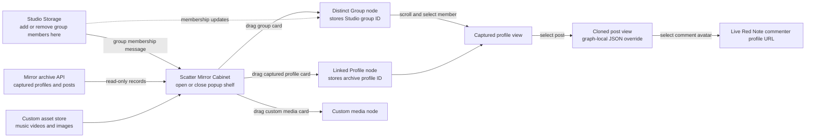
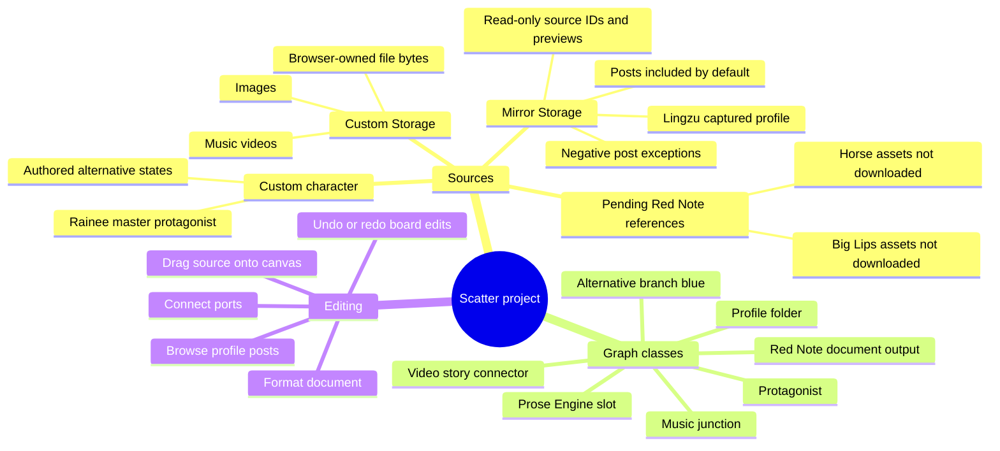
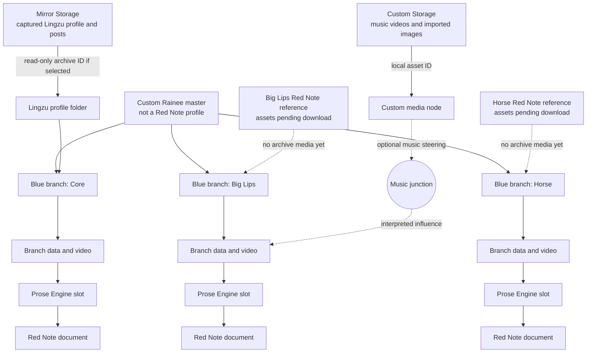

# Scatter ↔ Mirror Storage flow

Concept mockup: [Scatter storage and branch view](assets/scatter-mirror-flow-concept.png). This is a design image. Its portraits, asset names, and comments are illustrative, not archive evidence.

## Source ownership and present status

| Item | Origin | Current state |
| --- | --- | --- |
| Rainee, the master protagonist | Custom character | Authored in Scatter; not a Red Note profile |
| Lingzu | Red Note | Captured in Mirror Storage |
| Big Lips reference | Red Note | Reference identified; assets not downloaded yet |
| Horse reference | Red Note | Reference identified; assets not downloaded yet |
| Music videos | Custom | Import into Custom Storage, separate from the Red Note archive |

Big Lips and Horse may have designed branch and character cards on the prototype board. Those designs do not mean their Red Note source media has been captured or pinned as evidence. A pending source should remain visibly pending until its archive record and media are available.

## Mirror Cabinet UI logic

The Cabinet is a view of Studio groups plus captured Mirror records. Dragging creates linked graph objects, not copies of media bytes. Group membership can only be changed in Studio Storage; the graph reads it. A group may contain Studio fixtures or uncaptured references, which remain marked unresolved instead of becoming fake captured profiles. Clicking a captured member opens its paged post database; opening a post shows its clone, captured comments, and a JSON override saved only on the graph node. The comment avatar uses the captured author-profile URL when available. The current browser prototype opens that URL in a browser tab; routing it into the dedicated app-owned live Red Note window remains an integration step.

## Current implementation boundary

- The floating Mirror Cabinet has Groups, Profiles, and Custom tabs. Studio sends its locally saved group membership to the Cabinet through an origin-checked browser message. The Cabinet resolves each member against captured archive profiles; missing members remain unresolved. Dropping a group creates a distinct graph node with a scrollable captured-member list. Reopening Studio Storage is how membership is edited.
- The board reads the existing archive through a GET-only loopback proxy. A dragged profile node stores its archive profile ID and source ID; it does not clone or modify the source.
- A cloned post opened from a linked profile or group has a graph-local JSON override editor. Saving that override changes the graph node only, leaving captured post JSON intact.
- Only captured profiles appear in the Mirror Profiles dock. At present, Lingzu is captured; Big Lips and Horse have no downloaded source assets to drag from that dock. Rainee belongs to Custom character data, never to that dock.
- The profile browser pages through captured posts. Posts are positive by default; unchecking one saves a negative exception in that specific graph profile placement only. The archive stays unchanged.
- Custom file bytes live in this browser's IndexedDB and are referenced by custom asset ID from graph nodes. They are separate from the Red Note archive.
- The Prose Engine node is deliberately empty. It declares a place in the flow; it does not claim the narrative processor is built or running.
- The document card has a local editable draft, basic font and paragraph controls, HTML export, and a Red Note styled output card. Its side panel can load the first page of captured comments for a selected archive post, including source profile links where captured. This is reference display, not AI interpretation.
- Graph edits still persist in the prototype's browser storage. The semantic Scatter engine requires a revisioned Red Engine study pin with a content hash before it may process a Mirror source. Dragging a profile creates the UI archive pointer now; it does not silently create that study pin or queue AI analysis. Typed graph binding and engine-backed revisions require the next integration pass.

## DesignCraft source decision

[DesignCraft](https://github.com/storytold/designcraft) publishes a Rust page-layout application under MIT OR Apache-2.0. Its installed Windows folder contains executables, not reusable source. The source also has a full web build, but its README says that build has no control channel; embedding the entire application would not give a graph node a small editable document component. The graph prototype therefore uses a small browser editor with the requested font and text controls. No DesignCraft code has been copied or compiled into the graph. A dedicated DesignCraft document-model or WASM integration is a separate build task.
